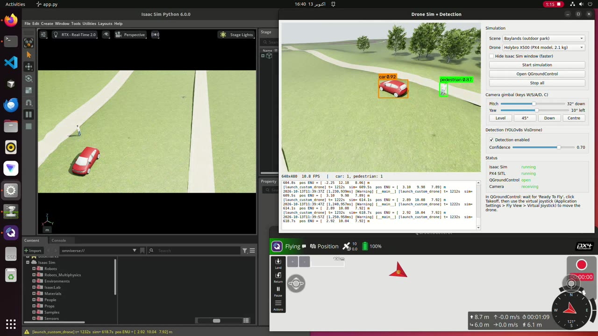
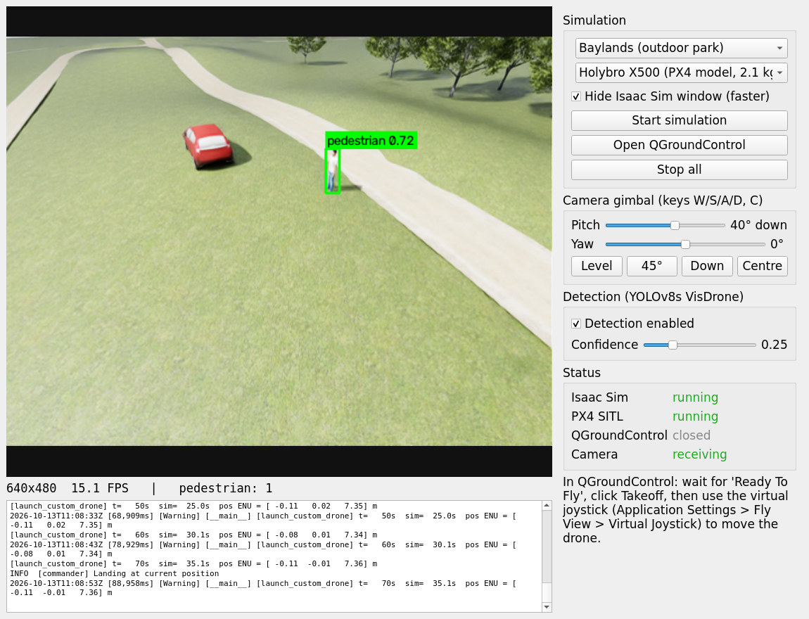
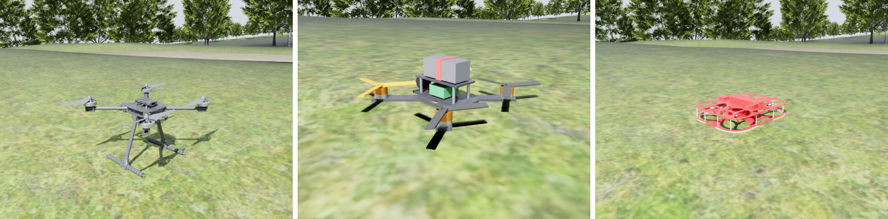
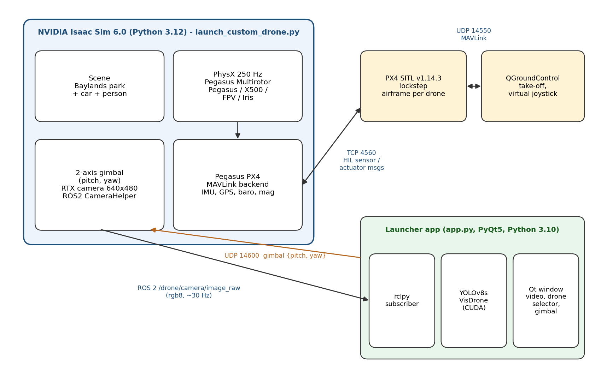

# Isaac Sim + PX4 UAV Perception Testbed

One desktop app that launches a **PX4-controlled drone in NVIDIA Isaac Sim** (Pegasus Simulator), opens
**QGroundControl** for take-off and joystick flight, and shows the drone's **gimbal camera with live YOLOv8 detection**,
in an outdoor park (Gazebo's Baylands) with a car and a person as targets.

[](docs/media/demo.mp4)

*Demo (2 min, click to play): Isaac Sim (left), the launcher app with detections (right), QGroundControl (bottom).
Holybro X500 take-off from QGC, gimbal moved from the app during flight, car and pedestrian detected, return to launch.*

| | |
|---|---|
|  |  |
| Launcher app: drone selector, gimbal, detection, status | Holybro X500, FPV 5-inch racer, Pegasus quad |

## Features

- **One-click launcher (PyQt5):** choose scene and drone, start Isaac Sim + PX4 SITL, open QGroundControl, stop everything cleanly.
- **Four drone models:** Pegasus quad (1.5 kg), **Holybro X500** built from PX4's own Gazebo model (meshes, mass, inertia, rotor layout), a **5-inch FPV racer** (0.6 kg, tuned PX4 airframe), and the 3DR Iris.
- **Real autopilot in the loop:** PX4 v1.14.3 SITL in lockstep with Isaac Sim physics at 250 Hz; fly with QGC exactly as with a real vehicle.
- **2-axis gimbal camera** controllable during flight (pitch −30° to 90°, yaw ±170°, 60°/s) from sliders, presets or W/S/A/D keys.
- **Onboard detection:** YOLOv8s fine-tuned on VisDrone (`models/best.pt`) on the GPU, colour-coded boxes for people and vehicles; latest-frame-only pipeline so the view never lags.
- **Photoreal outdoor scene:** Baylands park converted from Gazebo Fuel to USD with ground colliders, plus a car and a pedestrian.
- **ROS 2 Humble camera topic** (`/drone/camera/image_raw`, `camera_info`, `/clock`) that any other node can use.

## Architecture



Isaac Sim (Pegasus) simulates the drone and its sensors and exchanges HIL MAVLink messages with PX4 over TCP 4560 in lockstep.
PX4 talks to QGroundControl on UDP 14550. The gimbal camera is published over ROS 2; the app subscribes, runs YOLO, and
sends gimbal angles back over UDP 14600. Full write-up: [technical report (PDF)](docs/Drone_Sim_Detection_Report.pdf).

## Tested results

| Model | Take-off | Hover / land | Real-time factor | Gimbal in flight |
|---|---|---|---|---|
| Pegasus quad | 7.2 m | 90 s, landed | ≈ 0.47 | — |
| Holybro X500 | 7.2 m | 120 s, landed | ≈ 0.52 | 35°, 90°, 20° + 60° yaw |
| FPV 5-inch | 7.2 m | 120 s, landed | ≈ 0.51 | 35°, 90°, 20° + 60° yaw |

Person detected consistently (confidence 0.54–0.77); the low-poly car is detected intermittently (~0.37) at shallow angles.

## Requirements

Ubuntu 22.04, NVIDIA RTX GPU (tested on RTX 4060 8 GB), and:

| Component | Version | Notes |
|---|---|---|
| NVIDIA Isaac Sim | 6.0 | `ISAACSIM_PATH` (default `~/isaacsim`) |
| [Pegasus Simulator](https://github.com/PegasusSimulator/PegasusSimulator) | 6.0 | `pip install -e` into Isaac Sim's Python |
| PX4-Autopilot | v1.14.3 | `~/PX4-Autopilot`, built with `make px4_sitl_default` |
| ROS 2 | Humble | `/opt/ros/humble` |
| QGroundControl | AppImage | put it at `assets/QGroundControl.AppImage` |
| Python 3.10 venv | | `pip install -r requirements.txt` into `venv/` |

## Setup

```bash
git clone https://github.com/amanullah7x/isaac-px4-uav-perception-testbed.git ~/drone_px4_isaac
cd ~/drone_px4_isaac
python3 -m venv venv && venv/bin/pip install -r requirements.txt
tools/install_px4_airframes.sh ~/PX4-Autopilot      # isaac_iris / isaac_x500 / isaac_fpv airframes
tools/fetch_assets.sh                               # Baylands, car, person from Gazebo Fuel -> USD
# download QGroundControl.AppImage into assets/ and chmod +x it
./start_app.sh
```

In the app: pick a drone, **Start simulation**, **Open QGroundControl**, wait for *Ready To Fly*, **Takeoff**, then fly
with QGC's virtual joystick and point the camera with the gimbal panel.

Without the app:

```bash
./run_sim.sh --usd assets/x500/x500.usd --px4-airframe isaac_x500 --rotor-constant 8.54858e-6 \
             --env baylands --objects --cam-tilt 35
```

## Repository layout

| Path | What |
|---|---|
| `app.py`, `start_app.sh` | Launcher app |
| `launch_custom_drone.py`, `run_sim.sh` | Isaac Sim + Pegasus + PX4 simulation (scene, drone, gimbal camera, ROS 2) |
| `assets/` | Drone USDs (`pegasus.usd`, `x500/`, `fpv/`), car and person; Baylands is fetched by `tools/fetch_assets.sh` |
| `models/best.pt` | YOLOv8s fine-tuned on VisDrone |
| `px4/airframes/` | PX4 airframes for the Isaac drones |
| `tools/` | Mesh → USD converter, collider tagging, drone builder, asset fetch, airframe install |
| `mavlink_smoke_test.py`, `view_camera.py` | Scripted take-off/hover/land test; ROS 2 camera viewer |
| `docs/` | Technical report (PDF/DOCX), figures, demo video; `GUIDE.md` has the detailed setup notes |

## Roadmap / future work

**Next: FANET semantic communication (research)**
- Turn each frame's detections (class, confidence, box, timestamp, drone GPS pose, gimbal angles) into a compact
  **~72-byte semantic message** instead of streaming video (~0.9 MB per raw 640x480 frame), and geo-reference the boxes.
- Carry those messages over a **flying ad-hoc network simulated in NS-3** (and Linux network namespaces) between several
  drones and a ground station; measure task accuracy vs. bandwidth, latency, packet loss and age of information.
- Ground-truth logging of target poses and projected boxes for precision/recall and end-to-end latency metrics.

**Multi-drone and autonomy**
- Multi-UAV swarms in one scene (several Pegasus vehicles, one PX4 instance each), heterogeneous teams (X500 survey + FPV).
- Tracking (ByteTrack / BoT-SORT) with IDs and tracking metrics (MOTA, IDF1), then closed-loop target following via MAVLink offboard.
- Active perception: choose altitude and gimbal angle to maximise detection confidence.

**Simulation and models**
- Hexacopter model; MAVLink Gimbal Protocol v2 so QGC can drive the gimbal; FPV acro tuning.
- Moving targets (walking people, cars on the park roads), crowds and traffic; weather and lighting randomisation.
- Fine-tune the detector on synthetic frames from Isaac Replicator; TensorRT FP16 export.
- Hardware-in-the-loop with a real flight controller and an onboard Jetson running the same ROS 2 node.

## Credits and licences

Baylands (CC-BY 4.0), Hatchback and Standing person (CC0) are OpenRobotics models from
[Gazebo Fuel](https://app.gazebosim.org/OpenRobotics). X500 meshes are from PX4-Autopilot (BSD-3).
Built on NVIDIA Isaac Sim, Pegasus Simulator (BSD-3), PX4 (BSD-3), QGroundControl and Ultralytics YOLOv8 (AGPL-3.0).

**Author:** Amanullah Naseer, Department of Computer Engineering, National University of Sciences and Technology (NUST).
